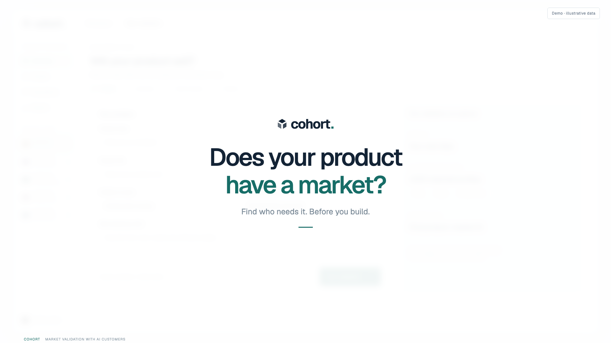

# Cohort

**Customer evidence. Commercial decisions.**

A product-research workspace for exploring customer populations, concepts, pricing and go-to-market decisions. Built for the Grok Bot hackathon, with a white-and-green interface matching the pitch.

**[Open the live dashboard](https://cohort-hackathon-26.vercel.app/workspace)** · **[Market panel](https://cohort-hackathon-26.vercel.app/#panel)** · **[Watch the presentation](https://cohort-hackathon-26.vercel.app/presentation)**

Choose **Enter demo workspace**; no password is required.

[](https://cohort-hackathon-26.vercel.app/presentation/#video)

**[Watch / download the MP4](https://cohort-hackathon-26.vercel.app/presentation/cohort-pmf-45s.mp4)** · **[Read the presentation PDF](https://cohort-hackathon-26.vercel.app/presentation/cohort-pmf-deck.pdf)** · [Repository media files](docs/presentation/cohort)

The 45-second presentation is an illustrative product walkthrough with music. It is not a recording of a live cloud Bot study or evidence of measured customer demand.

## Workspace

- Explore **12,000 synthetic customer profiles** with demographic charts, filters, search and CSV export.
- Create concept, usability and pricing studies; build surveys and compare A/B directions.
- Ask follow-up questions in individual focus-group conversations.
- Explore modeled price sensitivity and willingness to pay.
- Import customer-research documents and backtest scores against labeled real outcomes.
- Inspect the recorded Cohort Master market panel, including segments, debate and regional results.

Mock sign-in requires no password. Sample data, opinions, adoption scores and pricing curves are illustrative, not observed human behavior or validated conversion predictions. Native Grok Bot integration is a separate local workflow.

## Local development

This is an npm-workspace monorepo; the product lives in [`cohort/`](./cohort).

```sh
npm ci
npm run dev
```

Open **http://127.0.0.1:5173/workspace** and choose **Enter demo workspace**. The market panel is at **http://127.0.0.1:5173/#panel**.

```sh
npm run build
```

Node.js 22.12+ or 24+ is recommended. The build includes the presentation page, PDF, video and poster in `cohort/dist/presentation/`. The application and presentation use the same source revision.

## Vercel deployment

Production project: **[cohort-hackathon-26.vercel.app](https://cohort-hackathon-26.vercel.app)**.

[`vercel.json`](./vercel.json) configures installation, the monorepo build, the `cohort/dist` output directory and direct access to `/workspace` and `/presentation`.

[](https://vercel.com/new/clone?repository-url=https%3A%2F%2Fgithub.com%2FKabanosk%2Fgrok-bot-hackathon-26)

Import this GitHub repository into Vercel with the repository root as the project root. The hosted site serves the mock workspace and recorded market snapshot. Native cloud Bot credentials and local webhook endpoints are not exposed by the static deployment.

The published routes are `/workspace`, `/#panel`, `/presentation`, `/presentation/cohort-pmf-deck.pdf` and `/presentation/cohort-pmf-45s.mp4`.

For native Grok Bot setup, data boundaries and source structure, see the [product README](./cohort/README.md).
